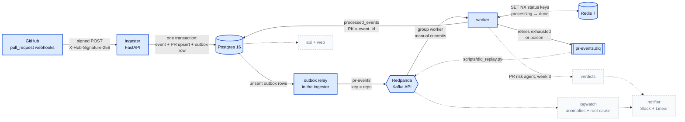

# Shipwatch

[](https://github.com/mokshad25/shipwatch/actions/workflows/ci.yml)

Shipwatch watches a GitHub repo and production logs, scores risky pull requests with an LLM agent,
and traces incidents back to the change that caused them, reporting to Slack and Linear.

## Architecture

Weeks 1–2 (highlighted) are built: the ingester stores each verified delivery and an outbox row in
one transaction, a relay publishes them to Kafka, and the worker processes each event effectively
once, with retries, a dead-letter queue and Redis dedupe. The rest arrives over weeks 3–8
([docs/ARCHITECTURE.md](docs/ARCHITECTURE.md)).



## Quickstart

Needs Docker, [uv](https://docs.astral.sh/uv/) and `make`.

```bash
git clone https://github.com/mokshad25/shipwatch.git && cd shipwatch
sed "s/^GITHUB_WEBHOOK_SECRET=.*/GITHUB_WEBHOOK_SECRET=$(openssl rand -hex 32)/" .env.example > .env
make up        # Postgres, Redpanda (+ Console on :8080), Redis, ingester on :8000, worker
make migrate   # create tables
make test      # tests against real Postgres, Redpanda and Redis
uv run python scripts/sign_and_send.py services/ingester/tests/fixtures/opened.json
make logs      # ingester + worker JSON logs: "outbox published", then "event processed"
```

The `sign_and_send.py` command replays a real captured `pull_request` delivery, signed with your
secret, and prints `202 {"status":"accepted"}`. Within a second the relay publishes it to `pr-events`
(see it in Redpanda Console at <http://localhost:8080>) and the worker records it in `processed_events`. Run it again and you get `202` again (a fresh delivery id each time);
pass `--delivery same-id` twice to see `200 {"status":"duplicate"}`.

## Send a signed request with curl

GitHub signs the raw body with HMAC-SHA256. `sign_and_send.py --signature` prints that header for
any body, so plain curl works:

```bash
BODY='{"zen":"Keep it logically awesome."}'
SIG=$(printf '%s' "$BODY" | uv run python scripts/sign_and_send.py - --signature)
curl -i http://localhost:8000/webhooks/github \
  -H "X-GitHub-Event: ping" \
  -H "X-GitHub-Delivery: $(uuidgen)" \
  -H "X-Hub-Signature-256: $SIG" \
  -H "Content-Type: application/json" \
  --data-binary "$BODY"
# HTTP/1.1 202 Accepted  {"status":"ignored"}  (recorded; only pull_request events update PRs)
```

| Response | Meaning |
|---|---|
| `202 accepted` | `pull_request` delivery stored, PR upserted |
| `202 ignored` | other event type, delivery recorded |
| `200 duplicate` | this `X-GitHub-Delivery` was already stored; nothing changed |
| `400` / `401` / `413` | malformed JSON or missing header / bad signature / body over 5 MB |

Full contract: [docs/SPEC_W1.md](docs/SPEC_W1.md).

## Real GitHub webhooks

`make forward` relays this repo's `pull_request` webhooks to the local ingester with
`gh webhook forward`, and `make sandbox-pr` drives a throwaway PR (against the `sandbox` branch, never
`main`) through opened → synchronize → edited → closed → reopened → merged. Setup and fixture capture:
[docs/SETUP_GITHUB.md](docs/SETUP_GITHUB.md).

## Make targets

| Target | Does |
|---|---|
| `make up` / `make down` | start / stop the stack (Postgres, Redpanda + Console, Redis, ingester, worker) |
| `make migrate` | apply Alembic migrations |
| `make test` | run pytest against the compose Postgres, Redpanda and Redis |
| `make deps` | start only what the tests need |
| `make lint` / `make fmt` | ruff check + format check / autofix |
| `make logs` | follow the ingester's and worker's JSON logs |
| `make forward` | forward real GitHub webhooks to localhost |
| `make sandbox-pr` | generate a full PR lifecycle on `sandbox` |
| `make capture` | record deliveries as test fixtures |
| `make deploy-demo SHA=…` | rebuild demoapp at a commit (`SHA=local` = working tree) and publish to `deploys` |
| `make load-demo` | 20 req/s against demoapp for 60 s (`RATE=`, `DURATION=`) |
| `make demo-logs` | follow demoapp's JSON logs |

## Operations

Delivery guarantees and what happens on each failure: [docs/SPEC_W2.md](docs/SPEC_W2.md).

**Redpanda Console** (<http://localhost:8080>): topics, messages, consumer group `worker` and its lag.

**Is anything stuck in the outbox?**

```bash
docker compose exec postgres psql -U shipwatch -c "SELECT count(*), max(attempts), min(created_at) FROM outbox WHERE sent_at IS NULL"
```

Unsent rows with growing `attempts` mean the relay can't reach Kafka; `last_error` says why. They
publish in order as soon as Kafka is reachable again; nothing needs replaying.

**Dead-letter queue.** Events that failed 3 attempts (or were invalid) are in `pr-events.dlq` with the
original message and error details. `scripts/dlq_replay.py` inspects and replays them:

```bash
uv run python scripts/dlq_replay.py                                   # counts per error type
uv run python scripts/dlq_replay.py --replay --dry-run                # list what would be replayed
uv run python scripts/dlq_replay.py --replay --error-type TimeoutError --limit 10
```

Replay republishes the original bytes to `pr-events` with the original key and an
`x-replayed-from: dlq/<partition>/<offset>` header. Fix the cause first: a message that fails again goes
back to the DLQ. Replaying the same message twice is safe, because the worker skips event ids it has
already processed. Validation errors (bad JSON or envelope) will fail again on replay; they're there
for inspection.

**Fault injection.** `FAIL_RATE=0.3 docker compose up -d worker` makes 30 % of processing attempts fail
(retryable); `FAIL_RATE=1` sends everything to the DLQ. Restart with `docker compose up -d worker`
to clear it.

**Crash test.** `uv run python scripts/crash_test.py` produces 1,000 events, SIGKILLs the worker after
2–5 s, restarts it and counts processed / duplicates / lost / DLQ. It appends to
[docs/results/crash_test.md](docs/results/crash_test.md). Options: `--fail-rate`, `--events`, `--rate`.

## Docs

[Build plan](docs/BUILD_PLAN.md) · [Architecture](docs/ARCHITECTURE.md) · [Week 1 spec](docs/SPEC_W1.md) ·
[Week 2 spec](docs/SPEC_W2.md) · [Crash test results](docs/results/crash_test.md) ·
[GitHub setup](docs/SETUP_GITHUB.md)
