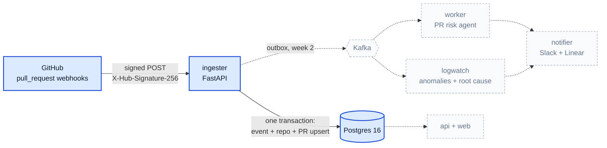

# Shipwatch

[](https://github.com/mokshad25/shipwatch/actions/workflows/ci.yml)

Shipwatch watches a GitHub repo and production logs, scores risky pull requests with an LLM agent,
and traces incidents back to the change that caused them, reporting to Slack and Linear.

## Architecture

Week 1 (highlighted) is a webhook ingester: it verifies GitHub's signature and stores every delivery
idempotently in Postgres. The rest arrives over weeks 2–8 ([docs/ARCHITECTURE.md](docs/ARCHITECTURE.md)).



## Quickstart

Needs Docker, [uv](https://docs.astral.sh/uv/) and `make`.

```bash
git clone https://github.com/mokshad25/shipwatch.git && cd shipwatch
sed "s/^GITHUB_WEBHOOK_SECRET=.*/GITHUB_WEBHOOK_SECRET=$(openssl rand -hex 32)/" .env.example > .env
make up        # Postgres + ingester on :8000
make migrate   # create tables
make test      # 54 tests against real Postgres
uv run python scripts/sign_and_send.py services/ingester/tests/fixtures/opened.json
```

The last command replays a real captured `pull_request` delivery, signed with your secret, and prints
`202 {"status":"accepted"}`. Run it again and you get `202` again (a fresh delivery id each time);
pass `--delivery same-id` twice to see `200 {"status":"duplicate"}`.

## Send a signed request with curl

GitHub signs the raw body with HMAC-SHA256. `sign_and_send.py --signature` prints that header for
any body, so plain curl works:

```bash
BODY='{"zen":"Keep it logically awesome."}'
SIG=$(printf '%s' "$BODY" | uv run python scripts/sign_and_send.py - --signature)
curl -i http://localhost:8000/webhooks/github \
  -H "X-GitHub-Event: ping" \
  -H "X-GitHub-Delivery: $(uuidgen)" \
  -H "X-Hub-Signature-256: $SIG" \
  -H "Content-Type: application/json" \
  --data-binary "$BODY"
# HTTP/1.1 202 Accepted  {"status":"ignored"}  (recorded; only pull_request events update PRs)
```

| Response | Meaning |
|---|---|
| `202 accepted` | `pull_request` delivery stored, PR upserted |
| `202 ignored` | other event type, delivery recorded |
| `200 duplicate` | this `X-GitHub-Delivery` was already stored; nothing changed |
| `400` / `401` / `413` | malformed JSON or missing header / bad signature / body over 5 MB |

Full contract: [docs/SPEC_W1.md](docs/SPEC_W1.md).

## Real GitHub webhooks

`make forward` relays this repo's `pull_request` webhooks to the local ingester with
`gh webhook forward`, and `make sandbox-pr` drives a throwaway PR (against the `sandbox` branch, never
`main`) through opened → synchronize → edited → closed → reopened → merged. Setup and fixture capture:
[docs/SETUP_GITHUB.md](docs/SETUP_GITHUB.md).

## Make targets

| Target | Does |
|---|---|
| `make up` / `make down` | start / stop Postgres and the ingester |
| `make migrate` | apply Alembic migrations |
| `make test` | run pytest against the compose Postgres |
| `make lint` / `make fmt` | ruff check + format check / autofix |
| `make logs` | follow the ingester's JSON logs |
| `make forward` | forward real GitHub webhooks to localhost |
| `make sandbox-pr` | generate a full PR lifecycle on `sandbox` |
| `make capture` | record deliveries as test fixtures |

## Docs

[Build plan](docs/BUILD_PLAN.md) · [Architecture](docs/ARCHITECTURE.md) · [Week 1 spec](docs/SPEC_W1.md) ·
[GitHub setup](docs/SETUP_GITHUB.md)
