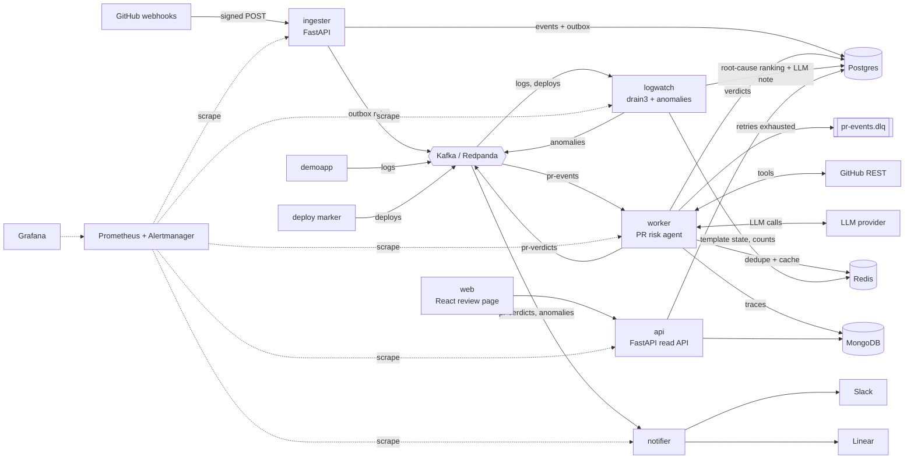

# Architecture

Final system (week 8). Week 1 builds only the ingester and Postgres.

## Components

**ingester.** A FastAPI service that receives GitHub webhooks. It checks `X-Hub-Signature-256` (HMAC-SHA256
over the raw body), stores the delivery and upserts the repo and pull request in one Postgres transaction,
and is idempotent on `X-GitHub-Delivery`. From week 2 it also writes an outbox row in the same transaction;
a relay publishes outbox rows to `pr-events` keyed by repo, so a Kafka outage never loses an accepted event.

**Kafka (Redpanda).** The backbone between services. `pr-events` (3 partitions, keyed by repo so each repo stays
ordered) and its DLQ, plus `pr-verdicts`, `logs`, `deploys` and `anomalies`. Delivery is at-least-once;
consumers make processing effectively-once.

**worker / PR risk agent.** Consumes `pr-events` with manual offset commits, retries with backoff and sends
poison messages to `pr-events.dlq`. Redis `SET NX` status keys dedupe events. For opened/synchronized PRs it
runs an LLM agent with four GitHub tools (diff, churn, author history, CI status); the LLM returns a
structured `RiskAssessment` and a pure, tested scoring function turns that into a 0–100 score and level.
The verdict goes to Postgres, the full tool-call trace to MongoDB, and a summary to `pr-verdicts`.

**demoapp.** A small FastAPI "orders" API that writes structured logs to `logs`, plus a deploy marker that
publishes `{service, sha, pr_number}` to `deploys`. It is the target for the bug-injection demo.

**logwatch / root cause.** Mines log templates with drain3 (state in Redis), keeps per-minute counts, and
flags new error templates and rate spikes as anomalies. For each anomaly it finds recent deploys, ranks the
included PRs by recency, file/stack-trace overlap and verdict score, and asks the LLM for a short incident
note that must quote its evidence. Incidents go to Postgres and `anomalies`.

**notifier.** Consumes `pr-verdicts` and `anomalies`, posts Block Kit cards to Slack above a threshold and
creates Linear issues for high-risk PRs and incidents, idempotently per verdict/incident.

**api + web.** A read-only FastAPI API (API-key auth) over verdicts, traces and incidents, plus a feedback
endpoint storing thumbs up/down in MongoDB. The React (Vite) page lists verdicts, shows factors and traces,
and collects feedback that feeds the eval dataset.

**evals.** A labeled dataset of reverted/hotfixed vs clean PRs, a runner reporting precision/recall/F1,
cost and latency, and a CI gate that blocks prompt changes that drop F1.

**observability.** structlog JSON logs with a correlation id (the delivery id) carried in Kafka headers,
Prometheus metrics on every service, a Grafana dashboard, four alert rules, and Sentry with a scrubber.

**deploy.** Multi-stage uv images, Kustomize manifests for k3s on a single EC2 instance, and a GitHub
Actions pipeline that builds, pushes to GHCR, rolls out, smoke-tests and rolls back on failure.
